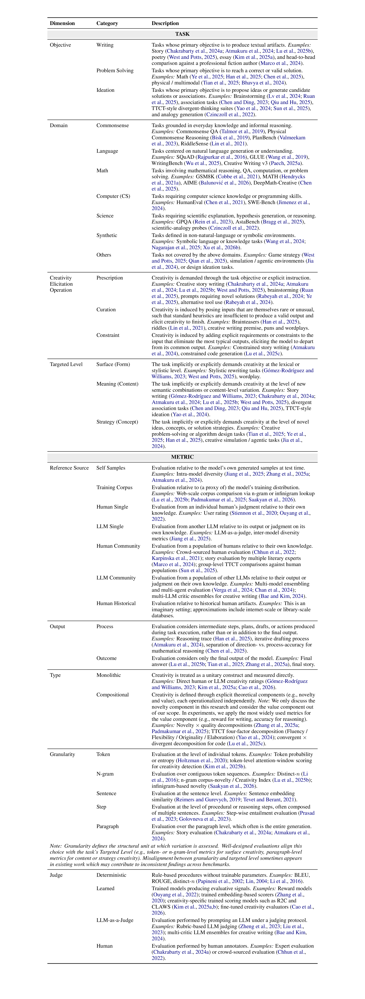

# Awesome LLM Creativity

A curated collection of research papers on **creativity in large language models and open-ended generation**.
The current scope focuses on generative models and tasks, primarily in the text modality.

For further reading on **LLM diversity**, see [Awesome LLM Diversity](https://github.com/YichenZW/awesome-llm-diversity), which focuses on variation across model outputs—including mode collapse, sampling and decoding, training, evaluation, and applications—whereas this list focuses on the generation and assessment of novel and valuable outputs.

**🤝 Contributing**

Contributions are welcome! If you know of an important paper that should be included:

1. Fork this repository.
2. Add the paper to the appropriate category.
3. Submit a pull request.

**⭐ Support**

If you find this collection useful, please consider starring it, following for updates, and sharing it with others.

**🛠️ Maintenance**

This repository is built and maintained using the [automatic maintainer](https://github.com/YichenZW/awesome-paperlist-maintainer). Papers are added after manual review and are sorted newest first within each category.

## Table of Contents

- [Taxonomy of Creativity Evaluation](#taxonomy-of-creativity-evaluation)
- [Papers on Optimization](#optimization)
  - [Sampling and Search](#sampling-and-search)
  - [Reinforcement Learning](#reinforcement-learning)
  - [Multi-Agent](#multi-agent)
  - [Hybrid Approaches and Others](#hybrid-approaches-and-others)
- [Papers on Evaluation, Datasets, and Benchmarks](#evaluation-datasets-and-benchmarks)
  - [Surveys and Comparative Analyses](#surveys-and-comparative-analyses)
- [Papers on Theory of Computational Creativity](#theory-of-computational-creativity)

## Taxonomy of Creativity Evaluation

The taxonomy organizes creativity evaluation along **Task** and **Metric** dimensions. Click the embedded preview to open the full-resolution continuous PDF.

  <a href="assets/taxonomy/creativity-evaluation-taxonomy.pdf"><strong>Open or download the full taxonomy PDF</strong></a>

## Optimization

### Sampling and Search

* **Roll the dice & look before you leap: Going beyond the creative limits of next-token prediction** [[paper](https://arxiv.org/abs/2504.15266)] 2025-04  
      Vaishnavh Nagarajan, Chen Henry Wu, Charles Ding, Aditi Raghunathan. **ICML 2025**.

* **Turning Up the Heat: Min-p Sampling for Creative and Coherent LLM Outputs** [[paper](https://arxiv.org/abs/2407.01082)] 2024-07  
      Minh Nhat Nguyen, Andrew Baker, Clement Neo, Allen Roush, Andreas Kirsch, Ravid Shwartz-Ziv. **ICLR 2025**.

### Reinforcement Learning

* **Creative Preference Optimization** [[paper](https://arxiv.org/abs/2505.14442)] 2025-05  
      Mete Ismayilzada, Antonio Laverghetta, Simone A. Luchini, Reet Patel, Antoine Bosselut, Lonneke van der Plas, Roger Beaty. **EMNLP 2025**.

* **Modifying Large Language Model Post-Training for Diverse Creative Writing** [[paper](https://arxiv.org/abs/2503.17126)] 2025-03  
      John Joon Young Chung, Vishakh Padmakumar, Melissa Roemmele, Yuqian Sun, Max Kreminski.

### Multi-Agent

* **Collective Critics for Creative Story Generation** [[paper](https://arxiv.org/abs/2410.02428)] 2024-10  
      Minwook Bae, Hyounghun Kim. **EMNLP 2024**.

* **LLM Discussion: Enhancing the Creativity of Large Language Models via Discussion Framework and Role-Play** [[paper](https://arxiv.org/abs/2405.06373)] 2024-05  
      Li-Chun Lu, Shou-Jen Chen, Tsung-Min Pai, Chan-Hung Yu, Hung-yi Lee, Shao-Hua Sun. **COLM 2024**.

* **Rapid AIdeation: Generating Ideas With the Self and in Collaboration With Large Language Models** [[paper](https://arxiv.org/abs/2403.12928)] 2024-03  
      Gionnieve Lim, Simon T. Perrault.

### Hybrid Approaches and Others

* **BILLY: Steering Large Language Models via Merging Persona Vectors for Creative Generation** [[paper](https://arxiv.org/abs/2510.10157)] 2025-10  
      Tsung-Min Pai, Jui-I Wang, Li-Chun Lu, Shao-Hua Sun, Hung-Yi Lee, Kai-Wei Chang.

* **Cooking Up Creativity: Enhancing LLM Creativity through Structured Recombination** [[paper](https://arxiv.org/abs/2504.20643)] 2025-04  
      Moran Mizrahi, Chen Shani, Gabriel Stanovsky, Dan Jurafsky, Dafna Shahaf.

* **Subjective Topic Meets LLMs: Unleashing Comprehensive, Reflective and Creative Thinking through the Negation of Negation** [[paper](https://doi.org/10.18653/v1/2024.emnlp-main.686)] 2024-11  
      Fangrui Lv, Kaixiong Gong, Jian Liang, Xinyu Pang, Changshui Zhang. **EMNLP 2024**.

* **Weaver: Foundation Models for Creative Writing** [[paper](https://arxiv.org/abs/2401.17268)] 2024-01  
      Tiannan Wang, Jiamin Chen, Qingrui Jia, Shuai Wang, Ruoyu Fang, Huilin Wang, Zhaowei Gao, Chunzhao Xie, Chuou Xu, Jihong Dai, Yibin Liu, Jialong Wu, Shengwei Ding, Long Li, Zhiwei Huang, Xinle Deng, Teng Yu, Gangan Ma, Han Xiao, Zixin Chen, Danjun Xiang, Yunxia Wang, Yuanyuan Zhu, Yi Xiao, Jing Wang, Yiru Wang, Siran Ding, Jiayang Huang, Jiayi Xu, Yilihamu Tayier, Zhenyu Hu, Yuan Gao, Chengfeng Zheng, Yueshu Ye, Yihang Li, Lei Wan, Xinyue Jiang, Yujie Wang, Siyu Cheng, Zhule Song, Xiangru Tang, Xiaohua Xu, Ningyu Zhang, Huajun Chen, Yuchen Eleanor Jiang, Wangchunshu Zhou.

* **User-Controlled Knowledge Fusion in Large Language Models: Balancing Creativity and Hallucination** [[paper](https://arxiv.org/abs/2307.16139)] 2023-07  
      Chen Zhang.

* **Unsupervised Melody-to-Lyrics Generation** [[paper](https://doi.org/10.18653/v1/2023.acl-long.513)] 2023-07  
      Yufei Tian, Anjali Narayan-Chen, Shereen Oraby, Alessandra Cervone, Gunnar Sigurdsson, Chenyang Tao, Wenbo Zhao, Yiwen Chen, Tagyoung Chung, Jing Huang, Nanyun Peng. **ACL 2023**.

* **Help Me Write a Poem: Instruction Tuning as a Vehicle for Collaborative Poetry Writing** [[paper](https://doi.org/10.18653/v1/2022.emnlp-main.460)] 2022-12  
      Tuhin Chakrabarty, Vishakh Padmakumar, He He. **EMNLP 2022**.

* **AmbiPun: Generating Humorous Puns with Ambiguous Context** [[paper](https://doi.org/10.18653/v1/2022.naacl-main.77)] 2022-07  
      Anirudh Mittal, Yufei Tian, Nanyun Peng. **NAACL 2022**.

## Evaluation, Datasets, and Benchmarks

* **Deep Associations, High Creativity: A Simple yet Effective Metric for Evaluating Large Language Models** [[paper](https://doi.org/10.18653/v1/2025.emnlp-main.550)] 2025-11  
      Ziliang Qiu, Renfen Hu. **EMNLP 2025**.

* **Artificial Hivemind: The Open-Ended Homogeneity of Language Models (and Beyond)** [[paper](https://arxiv.org/abs/2510.22954)] 2025-10  
      Liwei Jiang, Yuanjun Chai, Margaret Li, Mickel Liu, Raymond Fok, Nouha Dziri, Yulia Tsvetkov, Maarten Sap, Alon Albalak, Yejin Choi. **NeurIPS 2025**.

* **CreativityPrism: A Cross-Domain Evaluation Framework for Large Language Model Creativity** [[paper](https://arxiv.org/abs/2510.20091)] 2025-10  
      Zhaoyi Joey Hou, Bowei Alvin Zhang, Yining Lu, Bhiman Kumar Baghel, Anneliese Brei, Ximing Lu, Meng Jiang, Faeze Brahman, Snigdha Chaturvedi, Haw-Shiuan Chang, Daniel Khashabi, Xiang Lorraine Li.

* **CLAWS: Creativity Detection for LLM-Generated Solutions Using Attention Window of Sections** [[paper](https://arxiv.org/abs/2510.17921)] 2025-10  
      Keuntae Kim, Eunhye Jeong, Sehyeon Lee, Seohee Yoon, Yong Suk Choi. **NeurIPS 2025**.

* **HypoSpace: A Diagnostic Benchmark for Set-Valued Hypothesis Generation under Underdetermination and Sublinear Coverage Bounds** [[paper](https://arxiv.org/abs/2510.15614)] 2025-10  
      Tingting Chen, Beibei Lin, Zifeng Yuan, Qiran Zou, Hongyu He, Anirudh Goyal, Yew-Soon Ong, Dianbo Liu.

* **Curiosity-Driven LLM-as-a-judge for Personalized Creative Judgment** [[paper](https://arxiv.org/abs/2510.05135)] 2025-10  
      Vanya Bannihatti Kumar, Divyanshu Goyal, Akhil Eppa, Neel Bhandari.

* **Death of the Novel(ty): Beyond n-Gram Novelty as a Metric for Textual Creativity** [[paper](https://arxiv.org/abs/2509.22641)] 2025-09  
      Arkadiy Saakyan, Najoung Kim, Smaranda Muresan, Tuhin Chakrabarty. **ICLR 2026**.

* **Combinatorial Creativity: A New Frontier in Generalization Abilities** [[paper](https://arxiv.org/abs/2509.21043)] 2025-09  
      Samuel Schapiro, Sumuk Shashidhar, Alexi Gladstone, Jonah Black, Royce Moon, Dilek Hakkani-Tur, Lav R. Varshney.

* **Creativity Benchmark: A benchmark for marketing creativity for large language models** [[paper](https://arxiv.org/abs/2509.09702)] 2025-09  
      Ninad Bhat, Kieran Browne, Pip Bingemann.

* **Components of Creativity: Language Model-based Predictors for Clustering and Switching in Verbal Fluency** [[paper](https://doi.org/10.18653/v1/2025.conll-1.15)] 2025-07  
      Sina Zarrieß, Simeon Junker, Judith Sieker, Özge Alacam. **CoNLL 2025**.

* **Evaluating Text Creativity across Diverse Domains: A Dataset and Large Language Model Evaluator** [[paper](https://arxiv.org/abs/2505.19236)] 2025-05  
      Qian Cao, Xiting Wang, Yuzhuo Yuan, Yahui Liu, Fang Luo, Ruihua Song. **ICLR 2026**.

* **DeepMath-Creative: A Benchmark for Evaluating Mathematical Creativity of Large Language Models** [[paper](https://arxiv.org/abs/2505.08744)] 2025-05  
      Xiaoyang Chen, Xinan Dai, Yu Du, Qian Feng, Naixu Guo, Tingshuo Gu, Yuting Gao, Yingyi Gao, Xudong Han, Xiang Jiang, Yilin Jin, Hongyi Lin, Shisheng Lin, Xiangnan Li, Yuante Li, Yixing Li, Zhentao Lai, Zilu Ma, Yingrong Peng, Jiacheng Qian, Hao-Yu Sun, Jianbo Sun, Zirui Wang, Siwei Wu, Zian Wang, Bin Xu, Jianghao Xu, Yiyang Yu, Zichuan Yang, Hongji Zha, Ruichong Zhang.

* **Testing Language Creativity of Large Language Models and Humans** [[paper](https://doi.org/10.18653/v1/2025.nlp4dh-1.37)] 2025-05  
      Anca Dinu, Andra-Maria Florescu. **NLP4DH 2025**.

* **Base Models Beat Aligned Models at Randomness and Creativity** [[paper](https://arxiv.org/abs/2505.00047)] 2025-04  
      Peter West, Christopher Potts.

* **Automated Creativity Evaluation for Large Language Models: A Reference-Based Approach** [[paper](https://arxiv.org/abs/2504.15784)] 2025-04  
      Ruizhe Li, Chiwei Zhu, Benfeng Xu, Xiaorui Wang, Zhendong Mao.

* **Measuring LLM Novelty As The Frontier Of Original And High-Quality Output** [[paper](https://arxiv.org/abs/2504.09389)] 2025-04  
      Vishakh Padmakumar, Chen Yueh-Han, Jane Pan, Valerie Chen, He He.

* **Assessing the Creativity of LLMs in Proposing Novel Solutions to Mathematical Problems** [[paper](https://doi.org/10.1609/aaai.v39i24.34760)] 2025-04  
      Junyi Ye, Jingyi Gu, Xinyun Zhao, Wenpeng Yin, Guiling Wang. **AAAI 2025**.

* **NoveltyBench: Evaluating Creativity and Diversity in Language Models** [[paper](https://arxiv.org/abs/2504.05228)] 2025-04  
      Yiming Zhang, Harshita Diddee, Susan Holm, Hanchen Liu, Xinyue Liu, Vinay Samuel, Barry Wang, Daphne Ippolito.

* **Representation-to-Creativity (R2C): Automated Holistic Scoring Model for Essay Creativity** [[paper](https://doi.org/10.18653/v1/2025.findings-naacl.292)] 2025-04  
      Deokgi Kim, Joonyoung Jo, Byung-Won On, Ingyu Lee. **Findings of NAACL 2025**.

* **AI as Humanity's Salieri: Quantifying Linguistic Creativity of Language Models via Systematic Attribution of Machine Text against Web Text** [[paper](https://openreview.net/forum?id=ilOEOIqolQ)] 2025-04  
      Ximing Lu, Melanie Sclar, Skyler Hallinan, Niloofar Mireshghallah, Jiacheng Liu, Seungju Han, Allyson Ettinger, Liwei Jiang, Khyathi Chandu, Nouha Dziri, Yejin Choi. **ICLR 2025**.

* **Creativity or Brute Force? Using Brainteasers as a Window into the Problem-Solving Abilities of Large Language Models** [[paper](https://doi.org/10.52202/085713-4917)] 2025  
      Sophia Han, Howard Dai, Stephen Xia, Grant Zhang, Chen Liu, Lichang Chen, Hoang H. Nguyen, Hongyuan Mei, Jiayuan Mao, R. Thomas McCoy. **NeurIPS 2025**.

* **Evaluating LLMs' Divergent Thinking Capabilities for Scientific Idea Generation with Minimal Context** [[paper](https://arxiv.org/abs/2412.17596)] 2024-12  
      Kai Ruan, Xuan Wang, Jixiang Hong, Peng Wang, Yang Liu, Hao Sun.

* **EscapeBench: Towards Advancing Creative Intelligence of Language Model Agents** [[paper](https://arxiv.org/abs/2412.13549)] 2024-12  
      Cheng Qian, Peixuan Han, Qinyu Luo, Bingxiang He, Xiusi Chen, Yuji Zhang, Hongyi Du, Jiarui Yao, Xiaocheng Yang, Denghui Zhang, Yunzhu Li, Heng Ji. **ACL 2025**.

* **Large Language Models show both individual and collective creativity comparable to humans** [[paper](https://arxiv.org/abs/2412.03151)] 2024-12  
      Luning Sun, Yuzhuo Yuan, Yuan Yao, Yanyan Li, Hao Zhang, Xing Xie, Xiting Wang, Fang Luo, David Stillwell.

* **Do LLMs Agree on the Creativity Evaluation of Alternative Uses?** [[paper](https://arxiv.org/abs/2411.15560)] 2024-11  
      Abdullah Al Rabeyah, Fabrício Góes, Marco Volpe, Talles Medeiros.

* **Pron vs Prompt: Can Large Language Models already Challenge a World-Class Fiction Author at Creative Text Writing?** [[paper](https://doi.org/10.18653/v1/2024.emnlp-main.1096)] 2024-11  
      Guillermo Marco, Julio Gonzalo, M. Teresa Mateo-Girona, Ramón Del Castillo Santos. **EMNLP 2024**.

* **Evaluating n-Gram Novelty of Language Models Using Rusty-DAWG** [[paper](https://doi.org/10.18653/v1/2024.emnlp-main.800)] 2024-11  
      William Merrill, Noah A. Smith, Yanai Elazar. **EMNLP 2024**.

* **CS4: Measuring the Creativity of Large Language Models Automatically by Controlling the Number of Story-Writing Constraints** [[paper](https://arxiv.org/abs/2410.04197)] 2024-10  
      Anirudh Atmakuru, Jatin Nainani, Rohith Siddhartha Reddy Bheemreddy, Anirudh Lakkaraju, Zonghai Yao, Hamed Zamani, Haw-Shiuan Chang.

* **SimulBench: Evaluating Language Models with Creative Simulation Tasks** [[paper](https://arxiv.org/abs/2409.07641)] 2024-09  
      Qi Jia, Xiang Yue, Tianyu Zheng, Jie Huang, Bill Yuchen Lin.

* **Benchmarking Language Model Creativity: A Case Study on Code Generation** [[paper](https://arxiv.org/abs/2407.09007)] 2024-07  
      Yining Lu, Dixuan Wang, Tianjian Li, Dongwei Jiang, Sanjeev Khudanpur, Meng Jiang, Daniel Khashabi.

* **CreativEval: Evaluating Creativity of LLM-Based Hardware Code Generation** [[paper](https://doi.org/10.1109/LAD62341.2024.10691798)] 2024-06  
      Matthew DeLorenzo, Vasudev Gohil, Jeyavijayan Rajendran. **IEEE LAD 2024**.

* **Art or Artifice? Large Language Models and the False Promise of Creativity** [[paper](https://doi.org/10.1145/3613904.3642731)] 2024-05  
      Tuhin Chakrabarty, Philippe Laban, Divyansh Agarwal, Smaranda Muresan, Chien-Sheng Wu. **CHI 2024**.

* **How AI Processing Delays Foster Creativity: Exploring Research Question Co-Creation with an LLM-based Agent** [[paper](https://doi.org/10.1145/3613904.3642698)] 2024-05  
      Yiren Liu, Si Chen, Haocong Cheng, Mengxia Yu, Xiao Ran, Andrew Mo, Yiliu Tang, Yun Huang. **CHI 2024**.

* **Creative Problem Solving in Large Language and Vision Models -- What Would it Take?** [[paper](https://arxiv.org/abs/2405.01453)] 2024-05  
      Lakshmi Nair, Evana Gizzi, Jivko Sinapov. **EMNLP 2024**.

* **Assessing and Understanding Creativity in Large Language Models** [[paper](https://arxiv.org/abs/2401.12491)] 2024-01  
      Yunpu Zhao, Rui Zhang, Wenyi Li, Di Huang, Jiaming Guo, Shaohui Peng, Yifan Hao, Yuanbo Wen, Xing Hu, Zidong Du, Qi Guo, Ling Li, Yunji Chen.

* **MacGyver: Are Large Language Models Creative Problem Solvers?** [[paper](https://arxiv.org/abs/2311.09682)] 2023-11  
      Yufei Tian, Abhilasha Ravichander, Lianhui Qin, Ronan Le Bras, Raja Marjieh, Nanyun Peng, Yejin Choi, Thomas L. Griffiths, Faeze Brahman. **ACL 2024**.

* **Probing the Creativity of Large Language Models: Can models produce divergent semantic association?** [[paper](https://arxiv.org/abs/2310.11158)] 2023-10  
      Honghua Chen, Nai Ding. **EMNLP 2023**.

* **A Confederacy of Models: a Comprehensive Evaluation of LLMs on Creative Writing** [[paper](https://arxiv.org/abs/2310.08433)] 2023-10  
      Carlos Gómez-Rodríguez, Paul Williams. **EMNLP 2023**.

* **Do Androids Laugh at Electric Sheep? Humor "Understanding" Benchmarks from The New Yorker Caption Contest** [[paper](https://doi.org/10.18653/v1/2023.acl-long.41)] 2023-07  
      Jack Hessel, Ana Marasovic, Jena D. Hwang, Lillian Lee, Jeff Da, Rowan Zellers, Robert Mankoff, Yejin Choi. **ACL 2023**.

* **Ideas Are Dimes a Dozen: Large Language Models for Idea Generation in Innovation** [[paper](https://doi.org/10.2139/ssrn.4526071)] 2023-07  
      Karan Girotra, Lennart Meincke, Christian Terwiesch, Karl T. Ulrich. **Mack Institute for Innovation Management Working Paper**.

* **The Originality of Machines: AI Takes the Torrance Test** [[paper](https://doi.org/10.1016/j.yjoc.2023.100065)] 2023  
      Erik E. Guzik, Christian Byrge, Christian Gilde. **Journal of Creativity**.

* **Scientific and Creative Analogies in Pretrained Language Models** [[paper](https://arxiv.org/abs/2211.15268)] 2022-11  
      Tamara Czinczoll, Helen Yannakoudakis, Pushkar Mishra, Ekaterina Shutova. **EMNLP 2022**.

* **RiddleSense: Reasoning about Riddle Questions Featuring Linguistic Creativity and Commonsense Knowledge** [[paper](https://arxiv.org/abs/2101.00376)] 2021-01  
      Bill Yuchen Lin, Ziyi Wu, Yichi Yang, Dong-Ho Lee, Xiang Ren. **ACL 2021**.

* **Creativity Assessment: Comparability of the Electronic and Paper-and-Pencil Versions of the Wallach–Kogan Creativity Tests** [[paper](https://doi.org/10.1016/j.tsc.2010.09.004)] 2010-12  
      Sing Lau, Ping Chung Cheung. **Thinking Skills and Creativity**.

* **Torrance Tests of Creative Thinking: Norms-Technical Manual, Figural (Streamlined) Forms A and B** [[paper](https://search.worldcat.org/title/777160614)] 2008  
      E. Paul Torrance. **Scholastic Testing Service**.

* **Assessing the Work Environment for Creativity** [[paper](https://doi.org/10.2307/256995)] 1996-10  
      Teresa M. Amabile, Regina Conti, Heather Coon, Jeffrey Lazenby, Michael Herron. **Academy of Management Journal**.

* **Reliability and Validity of a Newly Constructed Multiple-Choice Creativity Instrument** [[paper](https://doi.org/10.1207/s15326934crj0901_8)] 1996-01  
      Elena Auzmendi, Aurelio Villa, Jamal Abedi. **Creativity Research Journal**.

* **Test for Creative Thinking–Drawing Production (TCT-DP)** [[paper](https://search.worldcat.org/title/50789377)] 1996  
      Klaus K. Urban, Hans G. Jellen. **Swets Test Services**.

* **Social Psychology of Creativity: A Consensual Assessment Technique** [[paper](https://doi.org/10.1037/0022-3514.43.5.997)] 1982-11  
      Teresa M. Amabile. **Journal of Personality and Social Psychology**.

* **Creativity Assessment Packet** [[paper](https://proedinc.com/products-6565.html)] 1980  
      Frank Williams. **D.O.K. Publishers**.

* **Measuring the Perceived Support for Innovation in Organizations** [[paper](https://doi.org/10.1037/0021-9010.63.5.553)] 1978-10  
      Saul M. Siegel, William F. Kaemmerer. **Journal of Applied Psychology**.

* **Creativity in the Classroom: What Research Says to the Teacher** [[paper](https://archive.org/details/creativityinclas0000torr)] 1977  
      E. Paul Torrance. **National Education Association**.

* **Thinking Creatively With Sounds and Words: Technical Manual (Research Edition)** [[paper](https://www.creativelearning.com/index.php?id=245&option=com_content&view=article)] 1973  
      Joe Khatena, E. Paul Torrance. **Personnel Press**.

* **Torrance Tests of Creative Thinking: Norms-Technical Manual** [[paper](https://search.worldcat.org/title/872562862)] 1966  
      E. Paul Torrance. **Personnel Press**.

* **Modes of Thinking in Young Children: A Study of the Creativity-Intelligence Distinction** [[paper](https://search.worldcat.org/title/11068267)] 1965  
      Michael A. Wallach, Nathan Kogan. **Holt, Rinehart and Winston**.

### Surveys and Comparative Analyses

* **Rethinking Creativity Evaluation: A Critical Analysis of Existing Creativity Evaluations** [[paper](https://arxiv.org/abs/2508.05470)] 2025-08  
      Li-Chun Lu, Miri Liu, Pin-Chun Lu, Yufei Tian, Shao-Hua Sun, Nanyun Peng. **ACL 2026**.

* **LitBench: A Benchmark and Dataset for Reliable Evaluation of Creative Writing** [[paper](https://arxiv.org/abs/2507.00769)] 2025-07  
      Daniel Fein, Sebastian Russo, Violet Xiang, Kabir Jolly, Rafael Rafailov, Nick Haber.

* **Creativity in LLM-based Multi-Agent Systems: A Survey** [[paper](https://arxiv.org/abs/2505.21116)] 2025-05  
      Yi-Cheng Lin, Kang-Chieh Chen, Zhe-Yan Li, Tzu-Heng Wu, Tzu-Hsuan Wu, Kuan-Yu Chen, Hung-yi Lee, Yun-Nung Chen.

* **We're Different, We're the Same: Creative Homogeneity Across LLMs** [[paper](https://arxiv.org/abs/2501.19361)] 2025-01  
      Emily Wenger, Yoed Kenett.

* **Steering Large Language Models to Evaluate and Amplify Creativity** [[paper](https://arxiv.org/abs/2412.06060)] 2024-12  
      Matthew Lyle Olson, Neale Ratzlaff, Musashi Hinck, Shao-yen Tseng, Vasudev Lal. **NeurIPS 2024**.

* **Creativity in AI: Progresses and Challenges** [[paper](https://arxiv.org/abs/2410.17218)] 2024-10  
      Mete Ismayilzada, Debjit Paul, Antoine Bosselut, Lonneke van der Plas.

* **Creativity and Machine Learning: A Survey** [[paper](https://doi.org/10.1145/3664595)] 2024-06  
      Giorgio Franceschelli, Mirco Musolesi. **ACM Computing Surveys**.

* **A Survey on Large Language Model Hallucination via a Creativity Perspective** [[paper](https://arxiv.org/abs/2402.06647)] 2024-02  
      Xuhui Jiang, Yuxing Tian, Fengrui Hua, Chengjin Xu, Yuanzhuo Wang, Jian Guo.

* **Evaluating Large Language Model Creativity from a Literary Perspective** [[paper](https://arxiv.org/abs/2312.03746)] 2023-11  
      Murray Shanahan, Catherine Clarke.

* **Pushing GPT's Creativity to Its Limits: Alternative Uses and Torrance Tests** [[paper](https://computationalcreativity.net/iccc23/papers/ICCC-2023_paper_90.pdf)] 2023-06  
      Fabricio Goes, Marco Volpe, Piotr Sawicki, Marek Grzes, Jacob Watson. **ICCC 2023**.

* **Approaches to Measuring Creativity: A Systematic Literature Review** [[paper](https://doi.org/10.1515/ctra-2017-0013)] 2017-12  
      Sameh Said-Metwaly, Wim Van den Noortgate, Eva Kyndt. **Creativity: Theories – Research – Applications**.

* **Diverse Perspectives of Creativity Testing: Controversial Issues When Used for Inclusion Into Gifted Programs** [[paper](https://doi.org/10.1177/0162353211417221)] 2011-09  
      Gay Lemons. **Journal for the Education of the Gifted**.

* **Creativity, Intelligence, and Personality: A Critical Review of the Scattered Literature** [[paper](https://doi.org/10.3200/MONO.132.4.355-430)] 2006-11  
      Mark Batey, Adrian Furnham. **Genetic, Social, and General Psychology Monographs**.

* **A Review of Creativity Principles Applied to Engineering Design** [[paper](https://doi.org/10.1243/0954408991529960)] 1999-02  
      G. Thompson, M. Lordan. **Proceedings of the Institution of Mechanical Engineers, Part E: Journal of Process Mechanical Engineering**.

* **Validation of Tests of Creative Thinking: A Review of Some Studies** [[paper](https://doi.org/10.1177/001440296503100603)] 1965-02  
      Kaoru Yamamoto. **Exceptional Children**.

## Theory of Computational Creativity

> **Scope note:** This section includes general foundations of human and computational creativity—definitions, cognitive processes, measurement, and social context. Most works here predate modern LLMs and are not LLM-specific; they provide the theoretical basis for studying creativity in LLMs.

* **Artificial Intelligence and the Threat of Creative Obsolescence** [[paper](https://doi.org/10.3998/ergo.10352)] 2026-07  
      Lindsay Brainard. **Ergo**.

* **Integrational Creativity: From Combining and Blending to Transforming and Resonating** [[paper](https://doi.org/10.1080/0020174X.2024.2389992)] 2024-08  
      Michael Beaney, Martha Kunicki. **Inquiry**.

* **The Process Definition of Creativity** [[paper](https://doi.org/10.1080/10400419.2023.2254573)] 2023-11  
      Adam E. Green, Roger E. Beaty, Yoed N. Kenett, James C. Kaufman. **Creativity Research Journal**.

* **Taking the U.S. Patent Office Criteria Seriously: A Quantitative Three-Criterion Creativity Definition and Its Implications** [[paper](https://doi.org/10.1080/10400419.2012.676974)] 2012-06  
      Dean Keith Simonton. **Creativity Research Journal**.

* **The Standard Definition of Creativity** [[paper](https://doi.org/10.1080/10400419.2012.650092)] 2012-01  
      Mark A. Runco, Garrett J. Jaeger. **Creativity Research Journal**.

* **Divergent Thinking as an Indicator of Creative Potential** [[paper](https://doi.org/10.1080/10400419.2012.652929)] 2012-01  
      Mark A. Runco, Selcuk Acar. **Creativity Research Journal**.

* **Computer Models of Creativity** [[paper](https://doi.org/10.1609/aimag.v30i3.2254)] 2009-09  
      Margaret A. Boden. **AI Magazine**.

* **Beyond Big and Little: The Four C Model of Creativity** [[paper](https://doi.org/10.1037/a0013688)] 2009-03  
      James C. Kaufman, Ronald A. Beghetto. **Review of General Psychology**.

* **Creativity** [[paper](https://doi.org/10.1146/annurev.psych.55.090902.141502)] 2004-02  
      Mark A. Runco. **Annual Review of Psychology**.

* **Models of the Creative Process: Past, Present and Future** [[paper](https://doi.org/10.1207/S15326934CRJ1334_07)] 2001-10  
      Todd I. Lubart. **Creativity Research Journal**.

* **Creating Creativity: 101 Definitions (What Webster Never Told You)** [[paper](https://books.google.ch/books?id=M2QpAAAACAAJ)] 2000-09  
      Andrei G. Aleinikov, Sharon Kackmeister, Ron Koenig. **Koenig & Associates**.

* **The Dark Side of Creativity** [[paper](https://doi.org/10.1080/10400419309534472)] 1993-01  
      Robert B. McLaren. **Creativity Research Journal**.

* **Creating Minds: An Anatomy of Creativity Seen Through the Lives of Freud, Einstein, Picasso, Stravinsky, Eliot, Graham, and Gandhi** [[paper](https://archive.org/details/creatingmindsana00gard)] 1993  
      Howard Gardner. **Basic Books**.

* **Creative Cognition: Theory, Research, and Applications** [[paper](https://doi.org/10.7551/mitpress/7722.001.0001)] 1992  
      Ronald A. Finke, Thomas B. Ward, Steven M. Smith. **MIT Press**.

* **Creativity: A Quarter Century of Progress** [[paper](https://doi.org/10.4324/9781315126265-2)] 1975  
      J. P. Guilford. **Perspectives in Creativity**.

* **The Nature of Human Intelligence** [[paper](https://books.google.com/books?id=QZp9AAAAMAAJ)] 1967  
      J. P. Guilford. **McGraw-Hill**.

* **Personality and the Realization of Creative Potential** [[paper](https://doi.org/10.1037/h0022403)] 1965-04  
      Donald W. MacKinnon. **American Psychologist**.

* **The Associative Basis of the Creative Process** [[paper](https://doi.org/10.1037/h0048850)] 1962  
      Sarnoff Mednick. **Psychological Review**.

* **An Analysis of Creativity** [[paper](https://www.jstor.org/stable/20342603)] 1961-04  
      Mel Rhodes. **Phi Delta Kappan**.

* **Blind Variation and Selective Retentions in Creative Thought as in Other Knowledge Processes** [[paper](https://doi.org/10.1037/h0040373)] 1960-11  
      Donald T. Campbell. **Psychological Review**.

* **The Processes of Creative Thinking** [[paper](https://doi.org/10.1037/13117-003)] 1959  
      Allen Newell, J. C. Shaw, Herbert A. Simon. **Contemporary Approaches to Creative Thinking**.

* **The Disposition Toward Originality** [[paper](https://doi.org/10.1037/h0048073)] 1955-11  
      Frank Barron. **The Journal of Abnormal and Social Psychology**.

* **Creativity and Culture** [[paper](https://doi.org/10.1080/00223980.1953.9712897)] 1953-10  
      Morris I. Stein. **The Journal of Psychology**.

* **Creativity** [[paper](https://doi.org/10.1037/h0063487)] 1950  
      J. P. Guilford. **American Psychologist**.

* **The Art of Thought** [[paper](https://search.worldcat.org/title/1114115)] 1926  
      Graham Wallas. **Jonathan Cape**.

* **The Psychology of Invention** [[paper](https://doi.org/10.1037/h0074372)] 1898-03  
      Josiah Royce. **Psychological Review**.

* **Genius** [[paper](https://books.google.com/books?id=ycIRAAAAYAAJ)] 1839  
      George Washington Bethune. **The Casket**.

